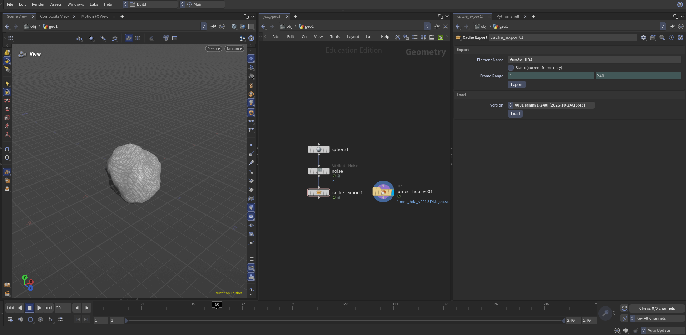

# Houdini Cache Tool

A small pipeline tool for SideFX Houdini that exports SOP geometry caches into a clean, versioned folder structure — and never overwrites an existing version.


## Why

Without a convention, caches end up as `output.abc` or `smoke_v2_final_OK.bgeo.sc` scattered around a project. This tool enforces one predictable layout so anyone (or any script) can find the right cache.

## Features

- Exports the selected SOP node to `$HIP/cache/<element>/vXXX/`
- Automatic version increment (`v001`, `v002`, ...) — existing versions are never touched
- Element names are sanitized (`Fumée Rouge` → `fumee_rouge`)
- Animated caches (timeline frame range) or static caches (current frame)
- Writes an `info.json` next to each version (user, date, source scene, node, frame range, Houdini version)
- Progress bar with cancel, and the timeline is restored to the artist's frame afterwards
- Clear error messages for common mistakes (unsaved scene, nothing selected, non-SOP node)
- Version browser: a menu lists existing versions with their type, frame range and date
- One-click **Load**: creates a File SOP reading the chosen version (reuses it if already loaded)

## Output layout

```
<hip folder>/
└── cache/
    └── fumee/
        ├── v001/
        │   ├── fumee_v001.0001.bgeo.sc
        │   ├── fumee_v001.0002.bgeo.sc
        │   └── info.json
        └── v002/
```

Example `info.json`:

```json
{
    "element": "fumee",
    "version": 1,
    "user": "hugo",
    "date": "2026-10-23T22:58:12",
    "hip_file": "/home/hugo/Documents/Pipeline_Tool_I/Hip/Cache_Demo.hipnc",
    "node": "/obj/geo1/mountain1",
    "frame_range": [1, 48],
    "houdini_version": "22.0.466"
}
```

## Requirements

- Houdini 22.0 (Python 3)
- Tested on Linux (Pop!_OS)

## Installation

1. Clone the repository:
   ```bash
   git clone https://github.com/Kaiser-Hugo/houdini-cache-tool.git
   ```
2. Copy `cache_tool.json` into your Houdini packages folder
   (`~/houdini22.0/packages/` on Linux; create it if needed).
3. Edit the copied file and replace `/path/to/houdini-cache-tool`
   with the folder where you cloned the repository.
4. Restart Houdini. The **Cache Export** node is now available in SOPs,
   and `import cache_tool` works from any Python script.

### Optional: shelf button

Create a new shelf tool with this script:
```python
import cache_tool
cache_tool.run()
```

## Usage

### Cache Export HDA (recommended)

1. Save your scene.
2. In a SOP network, drop a **Cache Export** node and connect it to the geometry you want to cache.
3. Set the **Element Name**, tick **Static** for a single frame, or adjust the **Frame Range**.
4. Click **Export**.
5. To reload a cache, pick a version in the **Version** menu
   (e.g. `v002  [anim 1-240]  (2026-10-25/17:38)`) and click **Load**.
   A File SOP reading that version is created next to the node.

### Shelf tool

1. Save your scene and select the SOP node to cache.
2. Click the shelf button, enter an element name, choose **Animated** or **Static**.

## Roadmap

- [x] Package the tool as an HDA with parameters and an Export button
- [x] Version browser: list existing versions and load one with a File SOP
- [ ] Optional shot level (`cache/<shot>/<element>/vXXX`)
- [ ] Clean up incomplete versions after a cancelled export

## Author

Hugo Kaiser — 3D / FX artist moving towards pipeline TD work.

## Development notes

This tool was built with the help of Claude (Anthropic) as a coding assistant.
I defined the specification and folder conventions, tested every feature in
Houdini, and reviewed and understood all of the code. Using AI this way —
directing it, verifying its output and catching issues such as deprecated
API calls — is part of what I wanted to practise with this project.